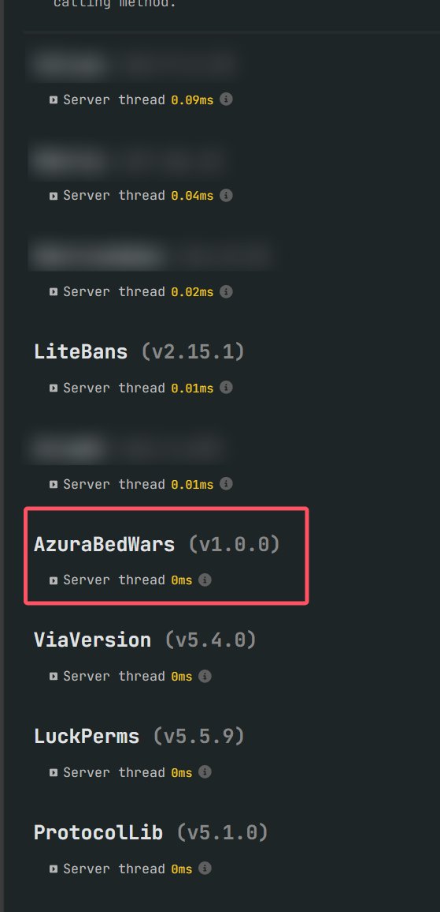

# AzuraBedWars

[](https://adoptium.net/)
[](https://www.minecraft.net/)
[](https://papermc.io/)
[](https://www.gnu.org/licenses/agpl-3.0)

[English](README.md) | [中文](README_CN.md)

---

A BedWars plugin currently under development

## Project Introduction

AzuraBedWars is a Minecraft bed wars plugin based on Spigot/Paper. This project is currently under development.

### Branches

- **master** — This branch contains the code for release builds.  
  Updates are pushed at the beginning of each month, usually from the 1st to the 3rd.
- **develop** — This branch is for daily updates and community pull requests.  
  It may contain unstable or experimental features.

### Preface

- This project is not yet complete and still needs many features to be finished. It is planned to be maintained until
  version 2.0.0
- One jar runs on Spigot and Paper from Minecraft 1.8.8 to the latest 26.3, and we plan to keep up with future releases
- If you use this project, you are responsible for any issues you encounter. We only recommend using it for testing
  purposes, not for production environments
- If you have suggestions or find issues, you can raise them in issues, and we will consider supporting them as soon as
  possible
- I am not very familiar with BukkitAPI, etc., so there may be many ambiguous places in the project

## Downloads

Every release on the [releases page](https://github.com/AzuraMC-Network/AzuraBedWars/releases) has two jars, pick one:

- `AzuraBedWars-<version>.jar` downloads its libraries on first start into `plugins/AzuraBedWars/libraries/`. The
  repositories it downloads from are set in `config.yml`
- `AzuraBedWars-<version>-offline.jar` embeds every library, for servers without internet access

Both jars check GitHub releases on startup and download a newer version of the same jar into `plugins/update/`, which
the server installs on the next restart. Set `updater.enabled` to `false` in `config.yml` to turn this off.

## Performance Showcase

- This is the spark profiler result after a 16-player game completion. Perhaps this is what can attract you to choose
  our project (the censored parts are anti-cheat plugins)



## Quick Start

### Demo Server

- [AzuraBedWars-DemoServer](https://github.com/MindsMaster/AzuraBedWars-DemoServer)
- You can download the packaged demo server here to use directly

### Requirements

- **Server**: Spigot or Paper, Minecraft 1.8.8 to 26.3. Future versions load with the newest module and a warning that they are untested
- **Java**: the plugin runs on Java 8 and newer, so use the Java version your Minecraft version needs

  | Minecraft | Java |
  | --- | --- |
  | 1.8.8 - 1.16.5 | 8+ |
  | 1.17.x | 16+ |
  | 1.18 - 1.20.4 | 17+ |
  | 1.20.5 - 1.21.11 | 21+ |
  | 26.x | 25+ |

- **Data Storage**: MySQL or MongoDB (required)
- **Dependencies**:
  - PacketEvents (required)
  - Vault (optional)
  - LuckPerms (optional)

### Configuration

Config files are created in `plugins/AzuraBedWars/` on first start:

| File | Contents |
| --- | --- |
| `config.yml` | Library repositories and the updater, read once at startup |
| `settings.yml` | Language, economy mode, map storage, lobby server |
| `database.yml` | MySQL or MongoDB connection |
| `gameplay.yml`, `display.yml`, `items.yml` | Game rules, scoreboard and tab list, special items |
| `generators.yml` | Resource generators |
| `timeline.yml` | Game stages and the actions they run |
| `upgrades.yml` | Team upgrades and traps |
| `shop/` | Shop menu, tier chains and one file per category |
| `lang/` | Player and admin texts, `en_US.yml` and `zh_CN.yml` |
| `devtools.yml` | Dev-mode MCP, see below |

- New installs default to `en_US`. Set `language` in `settings.yml` to `zh_CN` for Chinese texts, and missing config
  files are then created from Chinese templates
- Servers upgrading from an older version have their old config and messages files converted on first start, and keep
  Chinese texts
- `/bw reload [file]` reloads config files. Errors are reported with file and line, and a file with errors is not
  applied. Some changes wait for the next game or a restart, the command says which
- `/bw config check` checks every file, `/bw config schema` writes JSON schemas into `schema/` for editors that
  support the YAML language server
- Every file the plugin overwrites keeps its previous versions in `.history/`

### Extensions

Other plugins can add shop items, purchase actions and conditions, upgrade and trap effects, timeline actions and
placeholders, which server owners then place through the config files. See [Writing extensions](docs/extensions.md)
and the [grappling hook sample](examples/grapple).

### Dev-mode MCP

On a development server, AzuraBedWars can expose an [MCP](https://modelcontextprotocol.io/) endpoint so an AI client
such as Claude Code can read and edit config files and maps, check maps, scan worlds and show in-game markers. It is
off by default, keep it off on production servers.

1. Run `/bw devtools on`, or set `enabled: true` in `devtools.yml` and run `/bw devtools restart`
2. Run `/bw devtools status`, which prints the endpoint and a ready-to-paste `claude mcp add` command with the token

The endpoint listens on `127.0.0.1:25599` and only accepts local connections unless `allow-remote` is turned on. The
token is stored in `plugins/AzuraBedWars/devtools/token` and `/bw devtools rotate` replaces it. Writes are refused
while players without admin permission are online, and every change can be rolled back from `.history/`.

## Building

```
./gradlew build
```

Running Gradle needs JDK 17 or newer. The build itself uses a JDK 25 toolchain and downloads it when missing. Both jars
are written to `plugin/build/libs/`.

### Project Structure

- `api` — Public API, events and the NMS SPI
- `bootstrap` — Plugin entry that loads the game and its libraries in an isolated class loader
- `core` — Game logic running on the server
- `nms` — Per-version NMS implementations
- `plugin` — Packages the regular and offline plugin jars
- `examples/grapple` — Sample extension plugin, see [Writing extensions](docs/extensions.md)

## Contributing

We welcome all forms of contributions! Whether it's reporting bugs, suggesting new features, or submitting code, we are
very grateful.

### How to Contribute

1. **Fork the project**
2. **Create a feature branch** (`git checkout -b feature/YourFeatureName`)
3. **Commit your changes** (`git commit -m 'Add some AmazingFeature'`)
4. **Push to the branch** (`git push origin feature/YourFeatureName`)
5. **Create a Pull Request (please push to the develop branch)**

### Code Standards

- Follow Java coding conventions
- Use meaningful variable and method names
- Add appropriate comments
- Ensure code passes all tests

## License

This project is licensed under the GNU Affero General Public License v3.0 (AGPL-3.0)

## Authors

- **An5w1r_** - Main Developer
- **Ant1Aura** - Contributor
- **ImCur_** - Contributor
- **All0ra** - Contributor
- **Irina** - Contributor

## Contact

- **Email**: an5w1r@163.com
- **QQ Group**: 1046048297

## Disclaimer

This project is currently in development and may have unstable features. Please test thoroughly before using in
production environments.

---

⭐ If this project helps you, please give us a star! 
